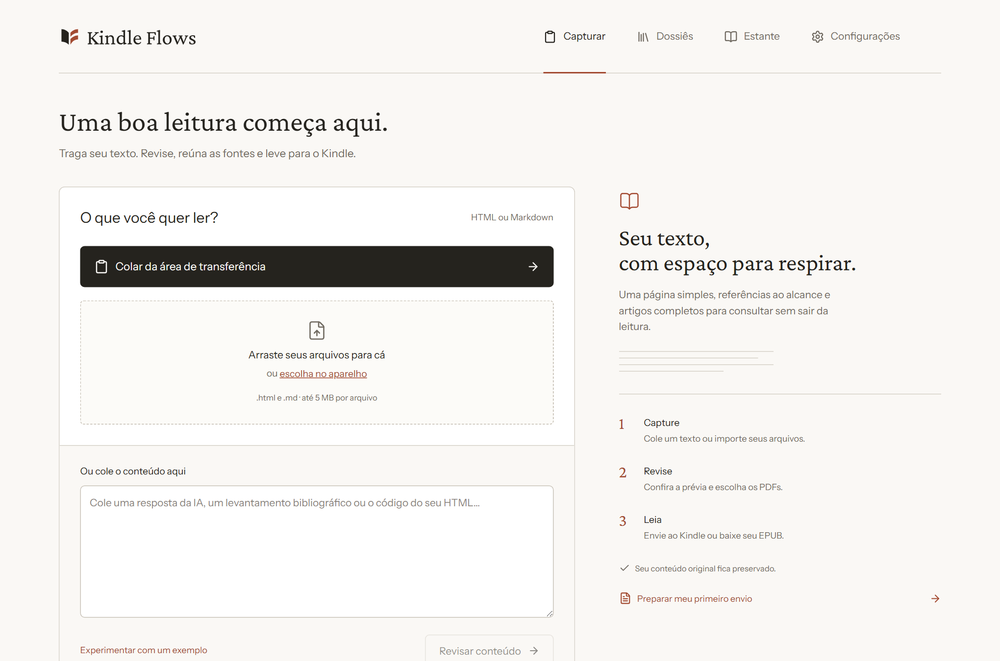
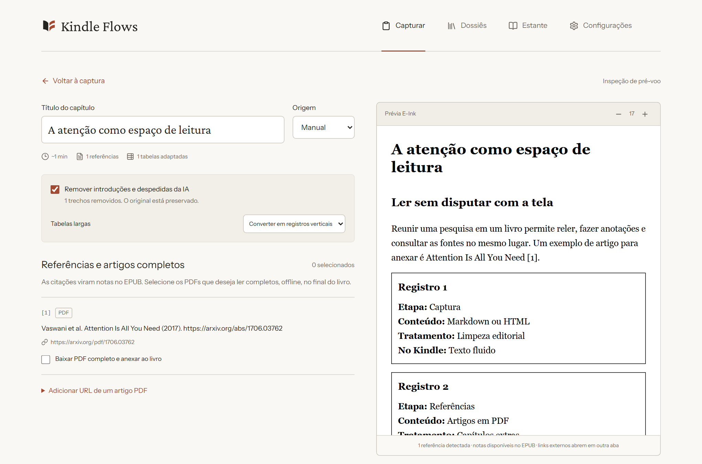
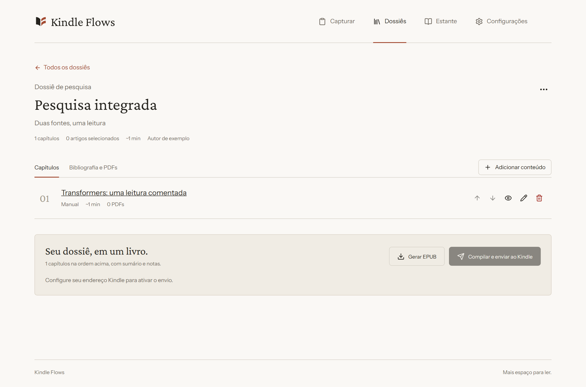
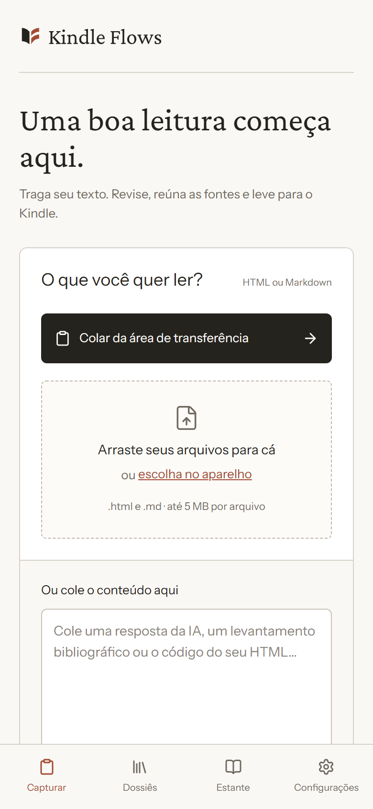
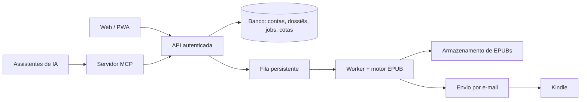
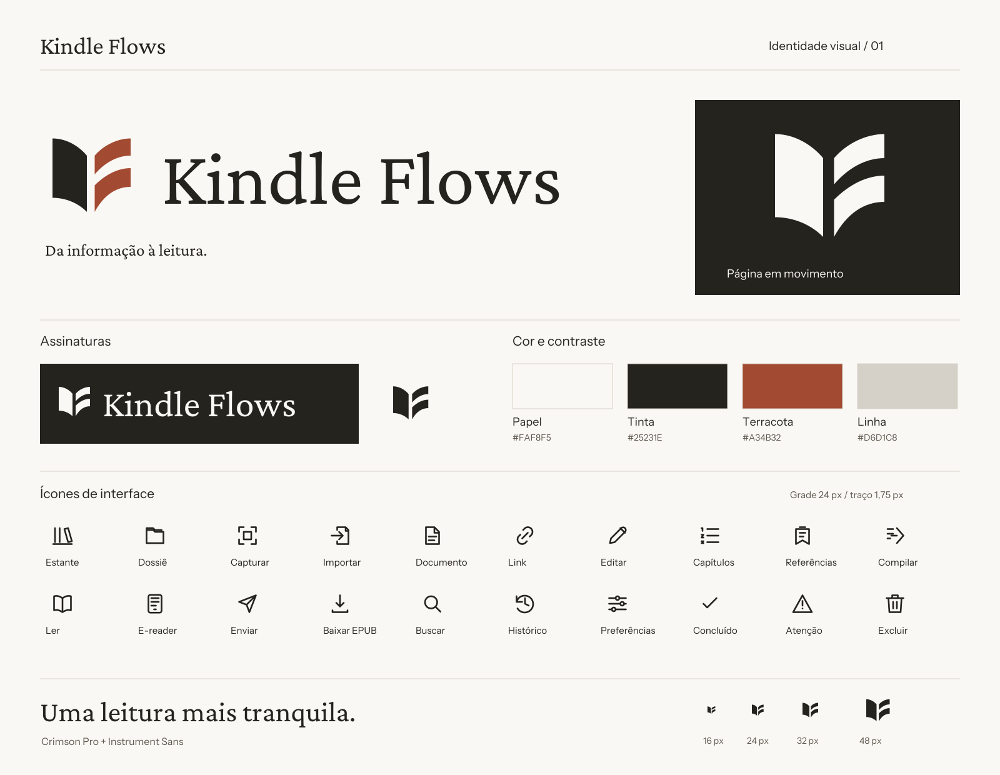

  

<strong>Da informação à leitura.</strong> 
Capture um texto ou uma pesquisa, revise, organize em dossiê e leia no Kindle como um EPUB bem formatado.

  <a href="https://kindleflows.com"><strong>kindleflows.com</strong></a> ·
  <a href="#case-study">Case study</a> ·
  <a href="#english">English</a>

> **Este repositório é uma vitrine do projeto.** O código-fonte do Kindle Flows é privado; aqui ficam a descrição, as decisões técnicas e os materiais de apresentação. O aplicativo em produção está em [kindleflows.com](https://kindleflows.com) (beta pessoal, sem garantia de disponibilidade).

## O problema

Pesquisas feitas com IA viram documentos longos, com tabelas, código, equações e dezenas de referências. Terminar a geração não resolve a parte seguinte: ler tudo com calma. Copiar para um e-mail ou PDF quebra a formatação e perde as referências; o Kindle é o melhor lugar para ler textos extensos.

## O que o Kindle Flows faz

1. **Captura** texto, Markdown ou HTML por colagem, arquivos, Share Target (Android), API ou MCP.
2. **Revisa** no inspetor: título, origem, tratamento de tabelas, remoção conservadora de conversa da IA e prévia em simulador Kindle.
3. **Organiza** capítulos em dossiês, com bibliografia unificada e PDFs de referência anexados sem duplicação.
4. **Compila** um EPUB3 com sumário, capa, notas com retorno, equações em SVG e anexos extraídos dos PDFs.
5. **Entrega** por e-mail ao Kindle ou como download, com fila persistente, reenvio e histórico.

## Telas

Capturas feitas com dados de exemplo.

## Case study

### Decisões que moldaram o projeto

- **Motor editorial independente.** O compilador não depende de React, Next, banco ou SMTP. Isso permitiu testá-lo isoladamente e reutilizá-lo na aplicação local e na hospedada.
- **Original preservado, saída conservadora.** O HTML original fica guardado; a sanitização usa allowlist, revela conteúdo oculto (abas, acordeões) e só remove conversa de IA quando tem confiança. Tudo é reversível no inspetor.
- **Fila persistida com lease.** Compilações são snapshots em fila SQL; um worker retoma jobs interrompidos. Um envio SMTP interrompido tem resultado ambíguo e **nunca é repetido automaticamente**, para não mandar o mesmo e-mail duas vezes.
- **Segurança no download de PDFs.** Só PDFs marcados pelo usuário são baixados; endereços privados e reservados são bloqueados e o DNS é fixado no socket em cada redirecionamento, com limites de tamanho, páginas e tempo.
- **Honestidade sobre limites.** Extração de PDF é heurística, e o app persiste e mostra esse aviso em vez de fingir fidelidade. Sucesso de envio significa "aceito pelo serviço de e-mail", não "chegou ao Kindle".
- **MCP com ações separadas.** Ferramentas de leitura, de escrita e de envio são distintas. Compilar nunca envia; enviar exige pedido explícito.

### Arquitetura

### Stack

Next.js (App Router) · TypeScript estrito · Tailwind · SQLite/libSQL com Drizzle · remark/cheerio · MathJax (SVG) · unpdf · JSZip · sharp · Nodemailer e Resend · PWA com service worker · Model Context Protocol (Streamable HTTP).

### Como foi validado

- Typecheck, lint e build; 32 testes automatizados (motor, banco, filas, entrega, segurança do downloader, sessão).
- Teste de ponta a ponta no Chromium (Playwright) com banco isolado e receptor SMTP local: captura, revisão, dossiês, download, envio, reinício real do servidor, Share Target, service worker, modo offline e telas móveis.
- EPUBs aprovados no **EPUBCheck 5.4.0**, incluindo um com PDF real do ArXiv anexado.
- Implantação em Linux validada, com testes, API e persistência após reinício.
- Em 26/10/2026, um livro de teste enviado de verdade chegou a um Kindle físico.

**Fora do que foi provado:** instalação como PWA e Share Target em aparelhos Android/iOS reais; envio com outras contas Amazon.

### Limites conhecidos

PDFs sem camada de texto precisam de OCR (não incluído). Figuras, equações e múltiplas colunas em PDFs podem exigir revisão. Conteúdo que só existe em JavaScript/canvas não pode ser reconstruído. Paywalls não são contornados.

## Identidade visual

Tipografia Crimson Pro e Instrument Sans, fundo papel e um vermelho terroso. Materiais em [`assets/brand`](assets/brand).

## Apoie o projeto

O Kindle Flows é independente e gratuito neste beta. Se ele foi útil, uma doação ajuda a manter o serviço no ar.

**Pix (chave e-mail):** `henriqueogs@gmail.com`

Sem valor mínimo e sem contrapartida: é só um agradecimento.

## Contato

Autor: [Henrique](https://github.com/henriqueogs) · [henriqueogs@gmail.com](mailto:henriqueogs@gmail.com). Perguntas e feedback: e-mail ou issue neste repositório.

---

## English

**Kindle Flows** turns long text and AI-generated research into well-formed EPUB3 books and delivers them to a Kindle. Capture Markdown/HTML (paste, files, Android Share Target, API or MCP), review in an inspector with a Kindle simulator, organize chapters into dossiers with a deduplicated bibliography and attached source PDFs, then compile and send.

Live (personal beta): **[kindleflows.com](https://kindleflows.com)**. The source code is private; this repository is a showcase with the architecture and engineering decisions described above (see *Case study*).

Highlights: an engine independent of framework and database; a persisted job queue with leases that never auto-retries an ambiguous send; SSRF-hardened PDF fetching; MCP tools that separate read, write and send; EPUBs validated with EPUBCheck 5.4.0; 32 automated tests plus a Playwright end-to-end run.

© Henrique. All rights reserved. Code is private; brand assets in this repository are not licensed for reuse.
